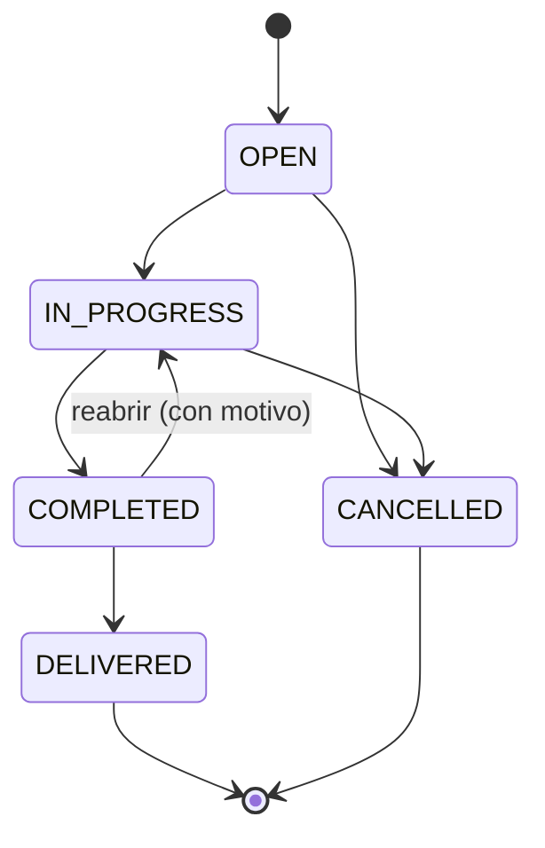
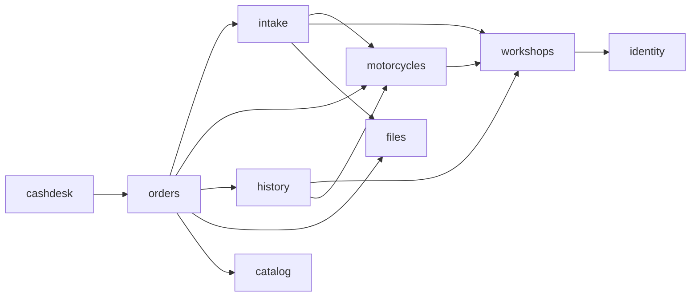

# Nítida — Especificación funcional y técnica (para desarrollo asistido por IA)

> **Nítida** — "¿Esa moto está nítida? Mírela en Nítida." SaaS para talleres de motos que ordena la operación del taller (órdenes, repuestos, caja) y, como subproducto, construye una **hoja de vida verificable de cada moto**: qué se le hizo, por qué, con qué repuestos y a qué kilometraje, en un historial que solo se puede agregar y va firmado.
>
> Proyecto final de *Pruebas y validación de software* + base de un negocio real. Equipo de 2.

---

## 0. Cómo usar este documento con una IA

1. Pásale a la IA **el documento completo** como contexto, más el *prompt maestro* de la sección 18.
2. Trabajen **por iteraciones** (sección 17). Cada iteración se pide por separado y termina con sus pruebas en verde.
3. Las secciones marcadas con **[REGLA DURA]** no se negocian. Si la IA propone violarlas, se rechaza el cambio.
4. Cuando algo no esté especificado, la IA debe **preguntar o elegir la opción más simple** (KISS) y dejarlo anotado en `docs/decisiones/` como ADR corto.
5. **Todo lo visual del frontend** (colores, tipografía, componentes, skeletons, estados vacíos, mensajes de error, textos y lo que no se debe hacer) vive en **`docs/DESIGN.md`**. Para cualquier tarea de interfaz, pásale a la IA este documento **y** `docs/DESIGN.md`. Si los dos se contradicen en algo visual, manda `DESIGN.md`; en reglas de negocio, seguridad o API, manda este documento.

---

## 0.1 Convención de idioma **[REGLA DURA]**

- **Código en inglés:** clases, interfaces, records, métodos, variables, paquetes, tablas, columnas, enums, eventos, códigos de error, rutas de la API y claves JSON.
- **Español para lo que ve la persona:** textos de la interfaz, mensajes de error mostrados al usuario (el `title` de Problem Details puede ir en español; el `code` va en inglés), correos y documentación funcional.
- Los nombres del dominio se traducen **siempre igual**, usando el mapa de la sección 4.1. Nada de mezclar (`OrdenService`, `getTaller()`).
- Las rutas de pantallas del frontend (`/t/[workshopId]/caja`, `/v/[token]`) pueden quedar en español porque las ve el usuario; los componentes, hooks y variables van en inglés.

---

## 1. Contexto y problema

- En Pasto circulan más de 180.000 motos, con unas 800 matrículas nuevas al mes.
- Apenas ~9 % de los talleres en Colombia usa algún software de gestión, y lo que existe está pensado sobre todo para carros.
- El mercado de motos usadas es muy informal: se estima que las transacciones formales no llegan al 5 %.
- El RUNT ya resuelve gratis el estado legal de una moto (robo, prendas, multas, propietarios). **Lo que nadie tiene es el historial mecánico registrado día a día en el taller.**
- Hay plataformas de compraventa (Motai, NextMoto, WCAR, Facebook Marketplace) que hacen peritajes puntuales. No compitimos con ellas como marketplace en el MVP.

### 1.1 Lente de incentivos ("la maldad") — por qué este diseño

| Actor | Qué gana | Maldad posible | Cómo la cubre el sistema |
|---|---|---|---|
| Dueño del taller (**quien paga**) | Control de órdenes, repuestos y caja; los clientes vuelven | Mecánicos que hacen trabajos "por fuera" o se llevan repuestos | Recepción obligatoria de cada moto, cuadre de caja y alertas de fuga |
| Mecánico deshonesto | — | Inventar registros para inflar el valor de una moto | Solo talleres **verificados** producen entradas "verificadas"; cada entrada va firmada, encadenada y con evidencia; las correcciones son enmiendas visibles |
| Dueño de la moto | Gratis; demuestra que la cuidó y la vende mejor | Esconder el historial malo | Una moto sin historial se vuelve señal de alerta; el historial viaja con la moto, no con la persona |
| Comprador de usada | Sabe qué compra | — | Link/QR público verificable que el vendedor comparte |
| La propia plataforma | — | Reescribir el historial | Cadena de hashes + publicación periódica de las cabezas de cadena (fase 2) |

---

## 2. Alcance por fases

| Fase | Contenido | Para la materia |
|---|---|---|
| **Fase 1 — SaaS del taller** | Talleres, miembros, motos, clientes, recepción, órdenes de trabajo, pagos, cuadre de caja, alertas de fuga, historial firmado, link público de verificación | **Sí, completa** |
| **Fase 2 — Portal del propietario** | Reclamar la moto, ver historial, recordatorios por kilometraje (Web Push), traspaso del historial al vender, publicación de cabezas de cadena | Parcial: reclamar + ver + traspasar |
| **Fase 3 — Mercado** | Índice local de precios de repuestos (datos propios agregados), referencia de precio de la moto, anuncios "con historial verificado", alertas de búsqueda, contacto protegido | No |

**Fuera de alcance siempre:** manejar dinero de terceros (custodia/pagos), scraping de sitios que lo prohíben, integración con APIs pagas, despliegue (por ahora todo corre con `docker compose up`).

---

## 3. Actores y roles

| Rol | Descripción |
|---|---|
| `PLATFORM_ADMIN` | Operador de Nítida. Verifica talleres, gestiona incidentes. No ve datos de clientes de los talleres salvo soporte auditado. |
| `WORKSHOP_OWNER` | Crea el taller, invita miembros, ve todo lo del taller, hace cuadres, ve alertas. |
| `MECHANIC` | Crea y avanza órdenes de trabajo, sube fotos. No ve caja ni alertas. |
| `FRONT_DESK` | Registra la entrada de motos, crea clientes, registra pagos. |
| `VEHICLE_OWNER` *(fase 2)* | Persona que reclamó una moto. Ve su historial, comparte links, inicia traspasos. |
| Público anónimo | Abre un link/QR de verificación. Solo lectura, sin datos personales. |

### 3.1 Matriz de permisos (MVP)

| Acción | ADMIN | DUEÑO | MECÁNICO | RECEPCIÓN | VEHICLE_OWNER | Público |
|---|---|---|---|---|---|---|
| Verificar/suspender taller | ✅ | — | — | — | — | — |
| Invitar/retirar miembros | — | ✅ | — | — | — | — |
| Registrar recepción de moto | — | ✅ | ✅ | ✅ | — | — |
| Crear/editar cliente | — | ✅ | — | ✅ | — | — |
| Crear/avanzar orden | — | ✅ | ✅ | — | — | — |
| Registrar pago | — | ✅ | — | ✅ | — | — |
| Entregar orden | — | ✅ | — | ✅ | — | — |
| Cuadre de caja, alertas | — | ✅ | — | — | — | — |
| Crear enmienda | — | ✅ | ✅ (solo propias) | — | — | — |
| Generar link público | — | ✅ | — | ✅ | ✅ | — |
| Ver historial verificado | — | ✅ (motos atendidas) | ✅ (motos atendidas) | ✅ (motos atendidas) | ✅ (sus motos) | ✅ (con link válido) |

**[REGLA DURA]** La autorización se decide en el backend. El frontend solo oculta botones.

---

## 4. Lenguaje ubicuo (glosario)

- **Taller**: inquilino (*tenant*) del sistema. Todo dato operativo pertenece a un taller.
- **Moto**: vehículo identificado por VIN (preferido) o placa. **Es global**, no pertenece a un taller.
- **Cliente**: persona que lleva una moto a un taller. **Pertenece al taller** (dato personal).
- **Recepción**: registro de que una moto entró al taller (placa, km, foto). Toda recepción debe terminar asociada a una orden o descartada con motivo.
- **Orden de trabajo (OT)**: lo que se le hace a una moto en una visita: diagnóstico (por qué), trabajos, repuestos, mano de obra, km, fotos.
- **Entrada de historial**: registro inmutable en la cadena de una moto. Se genera al entregar una OT, o por eventos especiales (alta, enmienda, cambio de odómetro, traspaso).
- **Cadena**: secuencia ordenada de entradas de una moto, enlazadas por hash.
- **Cabeza de cadena**: hash de la última entrada de una moto.
- **Enmienda**: corrección de una entrada anterior. No la borra; la referencia.
- **Link público**: URL con token aleatorio, con vencimiento y revocable, para ver el historial verificado de una moto.
- **Cuadre**: comparación diaria entre efectivo esperado (según pagos registrados) y efectivo contado.
- **Alerta de fuga**: señal determinística de posible pérdida de plata (ver RN-50).
- **Código de producto (GTIN/EAN/UPC)**: código de barras del empaque. Identifica el **tipo** de producto, no la unidad: todas las cajas iguales tienen el mismo código.
- **Serial**: identificador **único por unidad** (baterías, algunas piezas eléctricas, código de fecha de llantas, QR de autenticidad del fabricante cuando trae un código único).
- **Nivel de evidencia**: qué tan respaldado está un repuesto registrado (`MANUAL`, `SCANNED`, `UNIQUE_SERIAL`, `AUTHENTICITY_VERIFIED`). Ver RN-91.
- **Catálogo**: base propia de productos por código, que se llena con lo que escanean los talleres.

### 4.1 Mapa de nombres: dominio (español) → código (inglés)

| Dominio | Código | Dominio | Código |
|---|---|---|---|
| Taller | `Workshop` | Moto | `Motorcycle` |
| Cliente | `Customer` | Propietario | `VehicleOwner` |
| Recepción | `Intake` | Orden de trabajo (OT) | `WorkOrder` |
| Trabajo | `Job` | Repuesto | `Part` |
| Mano de obra | `laborCost` | Pago | `Payment` |
| Cuadre de caja | `CashCount` | Alerta de fuga | `LeakAlert` |
| Historial / cadena | `History` / `Chain` | Entrada de historial | `HistoryEntry` |
| Cabeza de cadena | `ChainHead` | Enmienda | `Amendment` |
| Link público | `PublicLink` | Código de reclamación | `ClaimCode` |
| Traspaso | `OwnershipTransfer` | Kilometraje | `Mileage` |
| Pesos colombianos (entero) | `CopAmount` | Autorización de datos | `DataConsent` |
| Catálogo / producto | `Catalog` / `Product` | Serial | `Serial` |
| Nivel de evidencia | `EvidenceLevel` | Llave de firma | `SigningKey` |
| Orquestador | `*UseCase` (p. ej. `DeliverOrderUseCase`) | Contexto de taller | `WorkshopContext` |

**Roles:** `PLATFORM_ADMIN` (admin de plataforma), `WORKSHOP_OWNER` (dueño del taller), `MECHANIC` (mecánico), `FRONT_DESK` (recepción), `VEHICLE_OWNER` (propietario de la moto).

---

## 5. Reglas de negocio

### 5.1 Talleres

- **RN-01** Un taller se registra con: nombre comercial, NIT o cédula del dueño, dirección, municipio, teléfono, foto de fachada. Nace en estado `PENDING_VERIFICATION`.
- **RN-02** Solo `PLATFORM_ADMIN` pasa un taller a `VERIFIED` o `SUSPENDED`. La verificación es manual (llamada/visita) y queda auditada con quién, cuándo y evidencia.
- **RN-03** Un taller `PENDING_VERIFICATION` puede operar normalmente, pero sus entradas de historial quedan marcadas como **"no verificadas"**. Al verificarse, las entradas **futuras** salen verificadas; las anteriores siguen "no verificadas" (no se reescribe nada).
- **RN-04** Un taller `SUSPENDED` no puede crear entradas nuevas. Sus entradas anteriores se muestran con la nota "taller suspendido el AAAA-MM-DD".
- **RN-05** Un usuario puede pertenecer a varios talleres con roles distintos. Cada solicitud HTTP opera en el contexto de **un** taller activo.

### 5.2 Motos e identidad

- **RN-10** Normalización de identificadores (idempotente): mayúsculas, sin espacios, guiones ni puntos.
- **RN-11** Placa de moto válida: `^[A-Z]{3}[0-9]{2}[A-Z]$` (formato actual). Se admite un formato antiguo `^[A-Z]{3}[0-9]{2}$` marcado `legacyPlateFormat=true`. Cualquier otro formato se rechaza.
- **RN-12** VIN válido: exactamente 17 caracteres alfanuméricos **sin** `I`, `O`, `Q`. Opcional en el MVP pero recomendado.
- **RN-13** Clave de identidad: si hay VIN, el VIN manda. Si solo hay placa, la placa. Si llega un VIN para una moto que existía solo con placa, se **asocia** (no se crea otra).
- **RN-14** La placa puede cambiar (raro). Se guarda historial de placas; la moto conserva su `motorcycleId` (UUID).
- **RN-15** Detección de duplicados: crear una moto con un VIN o placa que ya existe devuelve la moto existente, no un error ni un duplicado.
- **RN-16** Marca, línea, modelo (año) y cilindraje se registran como datos declarados; no se validan contra fuentes externas en el MVP.

### 5.3 Clientes y datos personales (Ley 1581)

- **RN-20** Cliente: nombre, teléfono (obligatorios); cédula y correo (opcionales).
- **RN-21** Antes de guardar un cliente se registra la **autorización de tratamiento de datos**: fecha/hora, versión de la política aceptada, medio (presencial/firma en pantalla), usuario que la registró. Sin autorización no se crea el cliente.
- **RN-22** **[REGLA DURA]** Ningún dato personal (nombre, cédula, teléfono, correo, foto de personas) entra jamás en el contenido de una entrada de historial. El historial solo referencia `motorcycleId` y `workshopId`.
- **RN-23** Supresión: un cliente puede pedir borrar sus datos. Se borran o anonimizan las tablas de clientes; el historial de la moto queda intacto porque no contiene datos personales (RN-22).
- **RN-24** El público nunca ve nombres de dueños. Solo "N traspasos registrados" con fechas.

### 5.4 Recepción (control de trabajos "por fuera")

- **RN-30** Toda moto que entra al taller se registra en **Recepción**: placa (o VIN), km del tablero, foto del tablero, foto de la moto, quién la recibió, fecha/hora.
- **RN-31** Una recepción queda `OPEN` hasta que se asocia a una OT o se **descarta** con motivo (`CONSULTATION_ONLY`, `CUSTOMER_WITHDREW`, `ENTRY_ERROR`).
- **RN-32** Recepción abierta por más de **24 h** (configurable por taller, mínimo 1 h, máximo 168 h) genera alerta `F1_INTAKE_WITHOUT_ORDER`.

### 5.5 Órdenes de trabajo

- **RN-40** Estados y transiciones permitidas:



  Cualquier otra transición se rechaza con `409 INVALID_TRANSITION`.
- **RN-41** Una OT tiene: recepción asociada (obligatoria), moto, cliente, **diagnóstico/motivo** (el "por qué", obligatorio, 10–2000 caracteres), trabajos (≥1 para pasar a `COMPLETED`), repuestos (0..n), mano de obra, km de ingreso, fotos antes/después, mecánico responsable, garantía (días y/o km, opcional).
- **RN-42** Trabajo: tipo (catálogo: `OIL_CHANGE`, `DRIVE_CHAIN_KIT`, `BRAKES`, `SUSPENSION`, `ELECTRICAL`, `ENGINE`, `TIRES`, `TUNE_UP`, `OTHER`) + descripción libre.
- **RN-43** Repuesto: nombre, referencia/código (opcional), marca, condición (`OEM`, `AFTERMARKET`, `USED`), cantidad (entero 1..999), precio unitario, **código de producto escaneado (opcional), serial (opcional), nivel de evidencia** y, si aplica, foto del sello de autenticidad. Ver sección 5.10.
- **RN-44** Dinero: pesos colombianos **enteros** (`long`), sin decimales. Rango por línea 0..50.000.000. Total de la OT = Σ(cantidad × precio unitario) + mano de obra. El total debe calcularse sin desbordamiento (usar `Math.multiplyExact`/`addExact`).
- **RN-45** Kilometraje:
  - km de la OT ≥ último km registrado en la cadena de la moto → válido (igual se acepta).
  - km menor al último → **rechazado** con `422 MILEAGE_REGRESSION`, salvo que en la misma operación se registre un `ODOMETER_CHANGE` con motivo y foto (RN-63).
  - Rango válido 0..999.999. Fuera de rango → rechazado.
- **RN-46** Mientras la OT no esté `DELIVERED`, se puede editar. Desde `DELIVERED` es **inmutable**; las correcciones se hacen con enmienda (RN-62).
- **RN-47** Para pasar a `DELIVERED`: la suma de pagos debe ser igual al total, **o** el saldo restante se registra como `STORE_CREDIT` (fiado) con cliente identificado. Total 0 solo se permite si la OT está marcada `isWarranty = true` y referencia una OT anterior del mismo taller y la misma moto.
- **RN-48** Al pasar a `DELIVERED` se publica el evento `OrderDelivered` con una **instantánea** de la OT. A partir de ahí se genera la entrada de historial (RN-60).
- **RN-49** Cancelar una OT con repuestos registrados exige motivo y genera alerta `F2_CANCELLED_WITH_PARTS`.

### 5.6 Caja, cuadre y alertas de fuga

- **RN-50** Alertas de fuga (reglas determinísticas, configurables por taller):
  - `F1_INTAKE_WITHOUT_ORDER`: recepción abierta más del umbral (RN-32).
  - `F2_CANCELLED_WITH_PARTS`: OT cancelada que tenía repuestos.
  - `F3_CASH_MISMATCH`: |contado − esperado| > tolerancia del taller (por defecto 0; máximo 50.000).
  - `F4_ZERO_TOTAL_WITHOUT_WARRANTY`: no debería ocurrir por RN-47; si se detecta (datos inconsistentes), alerta crítica.
  - `F5_STALLED_ORDER`: OT en `OPEN` o `IN_PROGRESS` sin cambios más de N días (por defecto 7).
  - `F6_DUPLICATE_SERIAL`: se intentó registrar un serial que ya está activo en otra moto (RN-94). Se crea en el taller que intentó registrarlo; el otro taller no recibe datos del primero.
- **RN-51** Pago: medio (`CASH`, `TRANSFER`, `CARD`, `STORE_CREDIT`), valor > 0, quién lo registró, fecha/hora. Los pagos no se editan; se **anulan** con motivo y se registra uno nuevo.
- **RN-52** Cuadre diario por taller: esperado = Σ pagos `CASH` no anulados del día (zona horaria `America/Bogota`). El dueño registra el contado. Estado `BALANCED` si |diferencia| ≤ tolerancia, si no `UNBALANCED` (+ alerta F3). Un cuadre cerrado no se edita; se puede reabrir con motivo (queda auditado).
- **RN-53** Las alertas no se borran: se **atienden** con comentario y quedan en el registro.

### 5.7 Historial firmado

- **RN-60** Tipos de entrada:
  - `INITIAL_REGISTRATION`: primera aparición de la moto en la plataforma; km declarado (marcado "declarado, no verificado").
  - `SERVICE`: generada desde una OT entregada.
  - `AMENDMENT`: corrige una entrada anterior (RN-62).
  - `ODOMETER_CHANGE`: declara cambio o reparación de tablero, con motivo, foto y nuevo km base.
  - `OWNERSHIP_TRANSFER` *(fase 2)*: cambio de propietario. Sin nombres.
- **RN-61** Cada entrada tiene `seq` consecutivo por moto (1, 2, 3…), sin huecos ni repetidos.
- **RN-62** Enmienda: referencia el `seq` corregido, trae motivo obligatorio y los campos corregidos. Solo la puede crear el **mismo taller** que creó la entrada original. La vista pública muestra la entrada original **y** su enmienda.
- **RN-63** `ODOMETER_CHANGE` reinicia la referencia de km para RN-45 a partir de esa entrada.
- **RN-64** Idempotencia: una OT produce **exactamente una** entrada `SERVICE` (restricción única sobre `source`).
- **RN-65** Una entrada de un taller `PENDING_VERIFICATION` se marca `workshopVerified = false` dentro del contenido firmado (RN-03).

### 5.8 Links públicos

- **RN-70** El link lo genera el taller (para una moto que atendió) o el propietario (fase 2).
- **RN-71** Token aleatorio de 128 bits (base64url, sin relleno). En base de datos se guarda **solo el hash SHA-256 del token**.
- **RN-72** Vencimiento por defecto 30 días (1..365). Válido si `now < expiresAt`. Revocable en cualquier momento.
- **RN-73** La página pública muestra: datos de la moto (marca, línea, modelo, cilindraje, placa parcialmente enmascarada `ABC**D`), lista de entradas con fecha, tipo, km, trabajos, repuestos (sin precios), taller (nombre comercial y municipio), estado de verificación de cada entrada y el **resultado de la verificación criptográfica de la cadena**.
- **RN-74** La página pública lleva `noindex`, límite de solicitudes por IP y no revela si un token existió o venció (mismo mensaje genérico en ambos casos).

### 5.9 Portal del propietario (fase 2, parcial en el MVP)

- **RN-80** Al entregar una OT, el recibo trae un **código de reclamación** de un solo uso (8 caracteres sin ambigüedades, vence en 30 días).
- **RN-81** El propietario crea su cuenta y reclama la moto con ese código. Una moto tiene como máximo un propietario activo.
- **RN-82** Traspaso: el propietario actual genera un código de traspaso; el nuevo dueño lo reclama; se crea una entrada `OWNERSHIP_TRANSFER`. El dueño anterior pierde acceso a entradas futuras; el historial sigue con la moto.

### 5.10 Repuestos: escaneo, seriales y evidencia

> **Principio:** escanear prueba que alguien tuvo **un empaque** en la mano, no que la pieza quedó instalada. El escaneo sirve para **calidad de datos y evidencia gradual**. La única regla antifraude fuerte es la de **seriales únicos**.

- **RN-90** Al agregar un repuesto se puede escanear el código del empaque o el serial con la cámara del celular, o escribirlo a mano. Escanear es opcional; el flujo manual siempre funciona.
- **RN-91** Niveles de evidencia (de menor a mayor). Se guarda el más alto que se cumpla:

  | Nivel | Condición |
  |---|---|
  | `MANUAL` | Datos escritos a mano, sin código escaneado |
  | `SCANNED` | Código de producto (GTIN) escaneado y con dígito verificador válido |
  | `UNIQUE_SERIAL` | Serial único registrado y aceptado por RN-94 |
  | `AUTHENTICITY_VERIFIED` | Sello o QR de autenticidad del fabricante revisado por el mecánico **con foto del sello**, y método anotado (p. ej. "verificado en el sitio oficial del fabricante", "holograma raspado") |

  La vista pública muestra el nivel de cada repuesto y un resumen ("8 de 12 repuestos con evidencia escaneada o fotográfica"). **[REGLA DURA]** La interfaz nunca dice "verificado" para `SCANNED`: dice "código escaneado".
- **RN-92** Códigos de producto: se aceptan EAN-13, EAN-8, UPC-A y GTIN-14, solo dígitos y con **dígito verificador válido** (módulo 10 con pesos 3/1). Un código con dígito inválido se rechaza con `422 INVALID_PRODUCT_CODE` (casi siempre es una lectura mala).
- **RN-93** Catálogo:
  - Si el código existe en el catálogo, se autocompletan nombre, marca y referencia (editables).
  - Si no existe, el mecánico los escribe y queda como producto **propuesto por el taller**.
  - MVP: catálogo **por taller**. Fase 2: catálogo **compartido**; un producto pasa a "confirmado" cuando lo confirman al menos 3 talleres distintos con los mismos datos.
  - El catálogo nunca guarda precios (los precios viven en las órdenes y alimentan el índice de la fase 3).
- **RN-94** Seriales únicos:
  - Normalización: mayúsculas, sin espacios; 4..64 caracteres de `[A-Z0-9-/.]`.
  - Un serial puede estar **activo en una sola moto a la vez** en toda la plataforma.
  - Registrarlo en una moto distinta a donde está activo → se **rechaza** el serial en esa línea (el repuesto puede guardarse sin serial y con menor nivel de evidencia) y se genera `F6_DUPLICATE_SERIAL`.
  - Registrarlo de nuevo en la **misma** moto (reinstalación) → se acepta sin alerta.
  - Al registrar en una OT un repuesto que **reemplaza** a uno con serial (misma categoría de trabajo), el mecánico puede marcar el serial anterior como `RETIRED`. Un serial retirado puede volver a activarse solo con motivo (p. ej. "pieza reparada y reinstalada").
  - **[REGLA DURA]** El mensaje de rechazo no revela en qué moto ni en qué taller está activo el serial.
- **RN-95** QR de fabricantes: muchos codifican una **URL**. El sistema guarda el contenido como texto, muestra el **dominio** de forma destacada y **nunca abre la URL automáticamente** ni la visita desde el servidor. El mecánico decide si la abre en su navegador (protección contra phishing y SSRF).
- **RN-96** Evidencia fotográfica recomendada para repuestos críticos (kit de arrastre, frenos, llantas, batería): foto de la pieza vieja junto a la nueva, con la moto de fondo. Si existe, se suma al resumen de evidencia aunque el repuesto sea `MANUAL`.
- **RN-97** Contenido del historial: el contenido **público** de cada repuesto incluye `evidenceLevel` y, si tiene serial, el **hash** del serial normalizado (`SHA-256`), no el serial en claro. El serial en claro va en el contenido **privado** (comprometido por `privateHash`).

---

## 6. Casos de uso (MVP)

Formato: **actor → precondiciones → flujo → errores**. Cada caso de uso = **un orquestador** (sección 7.3).

| ID | Caso de uso | Actor | Notas |
|---|---|---|---|
| UC-01 | Registrar taller | Usuario autenticado | RN-01 |
| UC-02 | Verificar/suspender taller | ADMIN | RN-02..04, auditado |
| UC-03 | Invitar miembro / aceptar invitación | DUEÑO / invitado | Invitación con token de un solo uso, vence en 72 h |
| UC-04 | Registrar recepción | RECEPCIÓN/MECÁNICO/DUEÑO | Crea o encuentra la moto (RN-13..15). Si la moto es nueva en la plataforma → `INITIAL_REGISTRATION` |
| UC-05 | Descartar recepción | Mismos | RN-31 |
| UC-06 | Crear cliente con autorización de datos | RECEPCIÓN/DUEÑO | RN-20..21 |
| UC-07 | Abrir OT desde recepción | MECÁNICO/DUEÑO | RN-41, valida km (RN-45) |
| UC-08 | Editar OT (trabajos, repuestos, fotos) | MECÁNICO/DUEÑO | Solo si no está entregada |
| UC-09 | Cambiar estado de OT | MECÁNICO/DUEÑO | RN-40 |
| UC-10 | Registrar / anular pago | RECEPCIÓN/DUEÑO | RN-51 |
| UC-11 | Entregar OT | RECEPCIÓN/DUEÑO | RN-47, publica `OrderDelivered` |
| UC-12 | Generar entrada de historial | Sistema (listener) | RN-60..65 |
| UC-13 | Crear enmienda | DUEÑO/MECÁNICO autor | RN-62 |
| UC-14 | Declarar cambio de odómetro | DUEÑO/MECÁNICO | RN-63 |
| UC-15 | Generar / revocar link público | DUEÑO/RECEPCIÓN | RN-70..72 |
| UC-16 | Ver historial público y verificación | Público | RN-73..74 |
| UC-17 | Cerrar / reabrir cuadre diario | DUEÑO | RN-52 |
| UC-18 | Listar y atender alertas | DUEÑO | RN-50, RN-53 |
| UC-19 | Evaluar alertas programadas | Sistema (scheduler) | F1, F5 cada 15 min |
| UC-20 | Reclamar moto (propietario) | VEHICLE_OWNER | RN-80..81 |
| UC-21 | Traspasar moto | VEHICLE_OWNER | RN-82 |
| UC-22 | Escanear repuesto (código de producto o serial) | MECÁNICO/DUEÑO | RN-90..93, autocompleta desde el catálogo |
| UC-23 | Registrar / retirar serial | MECÁNICO/DUEÑO | RN-94, puede generar F6 |
| UC-24 | Registrar verificación de autenticidad | MECÁNICO/DUEÑO | RN-91, RN-95, foto obligatoria |

### Casos de uso → orquestador

| UC | Orquestador | UC | Orquestador |
|---|---|---|---|
| UC-01 | `RegisterWorkshopUseCase` | UC-13 | `CreateAmendmentUseCase` |
| UC-02 | `ChangeWorkshopStatusUseCase` | UC-14 | `DeclareOdometerChangeUseCase` |
| UC-03 | `InviteMemberUseCase`, `AcceptInvitationUseCase` | UC-15 | `CreatePublicLinkUseCase`, `RevokePublicLinkUseCase` |
| UC-04 | `RegisterIntakeUseCase` | UC-16 | `ViewPublicHistoryUseCase` |
| UC-05 | `DiscardIntakeUseCase` | UC-17 | `CloseCashCountUseCase`, `ReopenCashCountUseCase` |
| UC-06 | `CreateCustomerUseCase` | UC-18 | `ResolveLeakAlertUseCase` |
| UC-07 | `OpenWorkOrderUseCase` | UC-19 | `EvaluateScheduledAlertsUseCase` |
| UC-08 | `EditWorkOrderUseCase` | UC-20 | `ClaimMotorcycleUseCase` |
| UC-09 | `ChangeWorkOrderStatusUseCase` | UC-21 | `TransferOwnershipUseCase`, `AcceptOwnershipTransferUseCase` |
| UC-10 | `RegisterPaymentUseCase`, `VoidPaymentUseCase` | UC-22 | `ScanPartUseCase` |
| UC-11 | `DeliverOrderUseCase` | UC-23 | `RegisterSerialUseCase`, `RetireSerialUseCase` |
| UC-12 | `RecordHistoryEntryUseCase` | UC-24 | `RecordAuthenticityCheckUseCase` |

### Ejemplo detallado — UC-11 Entregar OT

- **Precondiciones:** OT en `COMPLETED`; usuario con rol RECEPCIÓN o DUEÑO en el taller activo; taller no suspendido.
- **Flujo:**
  1. Cargar la OT con bloqueo optimista (`version`).
  2. Validar RN-47 (pagos = total, o saldo como crédito con cliente identificado; total 0 solo con garantía válida).
  3. Cambiar estado a `DELIVERED`, fijar `deliveredAt`.
  4. Generar código de reclamación (RN-80) y guardar su hash.
  5. Publicar `OrderDelivered(instantánea)` dentro de la misma transacción (registro de publicaciones de Modulith).
  6. Responder `200` con el recibo (incluye el código en claro **una sola vez**).
- **Errores:** `404` si la OT no es del taller (no revelar existencia), `409 INVALID_TRANSITION`, `409 VERSION_CONFLICT`, `422 INCOMPLETE_PAYMENTS`, `422 INVALID_WARRANTY`, `423 WORKSHOP_SUSPENDED`.

### Ejemplo detallado — UC-12 Generar entrada de historial

- **Disparador:** `OrderDelivered` (listener asíncrono de Modulith, transacción nueva).
- **Flujo:**
  1. Si ya existe una entrada con `source = ORDER:{orderId}` → terminar (idempotente, RN-64).
  2. Bloquear la fila de cabeza de cadena de la moto (`SELECT … FOR UPDATE`).
  3. Construir contenido público + contenido privado (sección 8.3), calcular `privateHash`.
  4. `seq = lastSeq + 1`; `hash = SHA-256(previousHash ‖ JCS(publicContent))`.
  5. Firmar `hash` con la llave Ed25519 vigente del taller.
  6. Insertar entrada, actualizar cabeza, publicar `HistoryEntryRecorded`.
- **Fallo:** si la firma o la base de datos fallan, la transacción se revierte y el registro de publicaciones reintenta. Nunca se inserta una entrada sin firma (**fail closed**).

---

## 7. Arquitectura

### 7.1 Estilo

- **Monolito modular** con **Spring Modulith 2.0** sobre **Spring Boot 4.1.x** (subir a 4.2 cuando salga y sea estable), **Java 21**.
- Un único desplegable, una base PostgreSQL, módulos con fronteras verificadas por `ApplicationModules.verify()` y **ArchUnit**.
- Frontend **Next.js** (App Router, TypeScript) servido aparte; habla con el backend por el mismo origen (proxy/rewrites de Next) para que las cookies sean *same-site*.
- KISS, SOLID, DRY, **sin sobreingeniería**: nada de microservicios, colas externas, CQRS completo ni *event sourcing*. Solo el historial es un registro de solo-agregar, por regla de negocio.

### 7.2 Módulos

| Módulo (paquete) | Responsabilidad | Expone (API pública) | Escucha eventos |
|---|---|---|---|
| `identity` | Usuarios, contraseñas, sesiones, roles por taller, invitaciones | `IdentityApi` (consultar usuario, membresías) | — |
| `workshops` | Taller, verificación, miembros, configuración, **llaves de firma** | `WorkshopsApi` (estado del taller, llave vigente, firmar) | — |
| `motorcycles` | Moto, identificadores, historial de placas, clientes, autorizaciones de datos, propietarios (fase 2) | `MotorcyclesApi` (buscar/crear moto, datos públicos de moto) | `HistoryEntryRecorded` (para actualizar resumen) |
| `intake` | Recepciones de motos | `IntakeApi` (consultar recepción abierta) | `WorkOrderOpened` (cierra la recepción) |
| `orders` | OT, trabajos, repuestos, pagos, máquina de estados | `OrdersApi` (consultas) | — |
| `history` | Cadena, firma, verificación, enmiendas, links públicos | `HistoryApi` (último km, verificar cadena) | `OrderDelivered`, `MotorcycleRegistered` |
| `cashdesk` | Cuadres, alertas de fuga, scheduler de alertas | — | `PaymentRegistered`, `PaymentVoided`, `WorkOrderCancelled`, `IntakeRegistered`, `SerialRejected` |
| `files` | Fotos: validación, limpieza de metadatos, almacenamiento | `FilesApi` (guardar, leer, hash) | — |
| `catalog` | Productos por código (GTIN), validación de códigos, **registro global de seriales** y su unicidad | `CatalogApi` (buscar producto, proponer producto, reservar/retirar serial) | `WorkOrderCancelled` (libera seriales de esa OT) |
| `notifications` *(fase 2)* | Web Push | — | eventos de recordatorio |
| `shared` | Núcleo mínimo: `CopAmount`, `Mileage`, IDs tipados, errores base, `WorkshopContext` | Todo (es *shared kernel*) | — |



> Las flechas son **dependencias síncronas permitidas** (llamadas a la `XxxApi`). Todo lo demás viaja por **eventos**. `orders → history` existe solo para consultar el último km (RN-45); la escritura en el historial ocurre por el evento `OrderDelivered`. `orders → catalog` es síncrona a propósito: la unicidad del serial (RN-94) se decide **dentro de la misma transacción** en que se guarda el repuesto, para que dos talleres no puedan activar el mismo serial a la vez.

**[REGLA DURA]** No hay ciclos entre módulos. `history` **no** depende de `orders` (recibe la instantánea en el evento). `ApplicationModules.verify()` corre en cada build.

### 7.3 Patrón: orquestadores y pocos "controllers"

- **Un orquestador por caso de uso** (`DeliverOrderUseCase`, `RegisterIntakeUseCase`, …). Método único `execute(Command) → Result`.
- El orquestador **coordina**: carga agregados, invoca reglas de dominio, persiste, publica eventos. **Es el único con `@Transactional`.**
- La lógica de negocio vive en el **dominio** (entidades y *value objects*): `WorkOrder.deliver(payments)`, `Mileage.validateAgainst(last)`, `Chain.append(...)`.
- **Capa HTTP:** una configuración de rutas por módulo con **`RouterFunction`** (Spring MVC funcional), más un *handler* delgado que traduce HTTP → comando → orquestador → HTTP. **Cero lógica de negocio en el handler.**
- Resultado: ~8 archivos de rutas para toda la aplicación, en lugar de decenas de controllers.

```java
// orders/web/OrderRoutes.java  (internal to the module)
@Configuration
class OrderRoutes {
    @Bean
    RouterFunction<ServerResponse> orderRoutes(OrderHandler h) {
        return route()
            .path("/api/v1/orders", b -> b
                .POST("", h::open)
                .GET("/{id}", h::detail)
                .PATCH("/{id}", h::edit)
                .POST("/{id}/transitions", h::changeStatus)
                .POST("/{id}/payments", h::registerPayment)
                .POST("/{id}/delivery", h::deliver))
            .build();
    }
}

// orders/web/OrderHandler.java
@Component
class OrderHandler {
    private final DeliverOrderUseCase deliverOrder; // orchestrator
    // ...constructor

    ServerResponse deliver(ServerRequest req) throws Exception {
        var command = new DeliverOrderUseCase.Command(
            WorkOrderId.of(req.pathVariable("id")),
            WorkshopContext.current(),            // workshop and user from the session
            req.body(DeliveryRequest.class).version());
        return ServerResponse.ok().body(ReceiptResponse.from(deliverOrder.execute(command)));
    }
}

// orders/application/DeliverOrderUseCase.java
@Service
public class DeliverOrderUseCase {
    public record Command(WorkOrderId orderId, WorkshopContext ctx, long version) {}
    public record Result(WorkOrderId orderId, CopAmount total, String claimCode) {}

    private final WorkOrderRepository orders;
    private final ClaimCodeGenerator claimCodes;
    private final ApplicationEventPublisher events;

    @Transactional
    public Result execute(Command command) {
        var order = orders.findByWorkshop(command.orderId(), command.ctx().workshopId())
                          .orElseThrow(NotFoundException::new); // 404, never reveals existence
        order.checkVersion(command.version());
        order.deliver(Instant.now());                          // RN-40, RN-47 live in the domain
        var code = claimCodes.next();
        order.assignClaimCode(code.hash());
        events.publishEvent(OrderDelivered.from(order));       // immutable snapshot
        return new Result(order.id(), order.total(), code.plainText());
    }
}
```

### 7.4 Estructura de paquetes

En Spring Modulith el **paquete raíz del módulo es su API pública**; los subpaquetes son internos.

```
co.nitida
├── NitidaApplication.java
├── shared/                      # shared kernel (minimal)
├── orders/
│   ├── OrdersApi.java           # public API (queries for other modules)
│   ├── OrderDelivered.java      # public events (records)
│   ├── WorkOrderCancelled.java
│   ├── PaymentRegistered.java
│   ├── application/             # orchestrators (one per use case: *UseCase)
│   ├── domain/                  # entities, value objects, rules, repository interfaces
│   ├── infrastructure/          # JPA, repository implementations
│   └── web/                     # RouterFunction + handler + HTTP DTOs
├── history/
│   ├── HistoryApi.java
│   ├── HistoryEntryRecorded.java
│   ├── application/
│   ├── domain/                  # Chain, HistoryEntry, JsonCanonicalizer, ChainVerifier
│   ├── crypto/                  # Ed25519, SHA-256 (no Spring dependencies)
│   ├── infrastructure/
│   └── web/
└── ... (rest of the modules with the same shape)
```

### 7.5 Eventos de dominio

Todos son `record` inmutables, en el paquete raíz del módulo emisor. Se publican dentro de la transacción del orquestador; los listeners usan `@ApplicationModuleListener` (asíncrono, después del commit, transacción nueva) con el **registro de publicaciones JDBC** de Modulith para reintentos.

| Evento | Emisor | Contenido mínimo |
|---|---|---|
| `MotorcycleRegistered` | motorcycles | motorcycleId, declaredMileage, workshopId, occurredAt |
| `IntakeRegistered` | intake | intakeId, workshopId, motorcycleId, mileage, occurredAt |
| `WorkOrderOpened` | orders | orderId, intakeId, workshopId |
| `OrderDelivered` | orders | orderId, workshopId, motorcycleId, mileage, diagnosis, jobs[], parts[] (with prices), laborCost, photoHashes[], mechanicId, warranty, deliveredAt |
| `WorkOrderCancelled` | orders | orderId, workshopId, hadParts, reason |
| `PaymentRegistered` / `PaymentVoided` | orders | paymentId, orderId, workshopId, method, amount, occurredAt |
| `HistoryEntryRecorded` | history | motorcycleId, seq, type, hash, workshopId |
| `SerialRejected` | catalog | workshopId (the one that tried), orderId, serialHash, occurredAt — **no data about the other motorcycle or workshop** |

**[REGLA DURA]** Todo listener es **idempotente** (restricción única o verificación previa) y fija el contexto de taller a partir del evento (no hay sesión HTTP).

---

## 8. Modelo de datos (PostgreSQL)

Migraciones con **Flyway** (una carpeta por módulo, prefijo con el nombre del módulo). Esquemas, tablas y columnas en inglés y `snake_case`. Claves primarias UUID v7. Todas las tablas operativas llevan `workshop_id`. Tiempos en `timestamptz` (UTC); la zona `America/Bogota` solo se usa para "el día" del cuadre.

### 8.1 Tablas principales (resumen)

```text
identity.app_user(id, email UNIQUE, password_hash, created_at, locked_until, failed_attempts)
identity.membership(user_id, workshop_id, role, active)  PK(user_id, workshop_id, role)
identity.invitation(id, workshop_id, email, role, token_hash, expires_at, used_at)

workshops.workshop(id, name, document_number, address, municipality, phone, status, verified_at, verified_by, settings_jsonb, version)
workshops.signing_key(id, workshop_id, algorithm='Ed25519', public_key bytea, encrypted_private_key bytea, nonce bytea, kek_version, created_at, retired_at)

motorcycles.motorcycle(id, vin UNIQUE NULL, current_plate UNIQUE NULL, legacy_plate_format, brand, line, model_year, displacement_cc, created_at)
motorcycles.plate_history(motorcycle_id, plate, valid_from, valid_to)
motorcycles.customer(id, workshop_id, full_name, phone, national_id NULL, email NULL, created_at, erased_at NULL)
motorcycles.data_consent(id, workshop_id, customer_id, policy_version, channel, recorded_by, recorded_at)
motorcycles.vehicle_owner(motorcycle_id, user_id, valid_from, valid_to NULL)        -- phase 2
motorcycles.claim_code(id, motorcycle_id, code_hash, expires_at, used_at)           -- phase 2

intake.intake(id, workshop_id, motorcycle_id, mileage, odometer_photo_id, motorcycle_photo_id, received_by, status, discard_reason NULL, work_order_id NULL, created_at)

orders.work_order(id, workshop_id, intake_id UNIQUE, motorcycle_id, customer_id, status, diagnosis, intake_mileage, labor_cost, total, warranty_days NULL, warranty_km NULL, is_warranty, warranty_ref_order_id NULL, mechanic_id, delivered_at NULL, version)
orders.job(id, work_order_id, type, description)
orders.part(id, work_order_id, name, reference NULL, brand, condition, quantity, unit_price,
            product_code NULL, code_type NULL, serial_id NULL, evidence_level,
            authenticity_photo_id NULL, authenticity_method NULL, replacement_photo_id NULL)
orders.work_order_photo(work_order_id, file_id, moment ENUM('BEFORE','AFTER'))
orders.payment(id, workshop_id, work_order_id, method, amount, recorded_by, recorded_at, voided_at NULL, void_reason NULL)

history.chain_head(motorcycle_id PK, last_seq, last_hash, version)
history.history_entry(id, motorcycle_id, seq, type, workshop_id, source UNIQUE NULL, public_content jsonb, private_content jsonb, private_hash bytea, previous_hash bytea, hash bytea, signature bytea, key_id, recorded_at)
            UNIQUE(motorcycle_id, seq)
history.public_link(id, motorcycle_id, created_by, token_hash UNIQUE, expires_at, revoked_at NULL)

cashdesk.cash_count(id, workshop_id, day date, expected, counted, difference, status, closed_by, closed_at, reopen_reason NULL) UNIQUE(workshop_id, day)
cashdesk.leak_alert(id, workshop_id, type, reference_id, details jsonb, created_at, resolved_at NULL, resolved_by NULL, comment NULL)

files.stored_file(id, workshop_id, mime_type, size_bytes, sha256, path, created_at)

catalog.product(id, workshop_id NULL, code, code_type, name, brand, reference NULL, status ENUM('PROPOSED','CONFIRMED'), created_at)
            UNIQUE(workshop_id, code)                 -- MVP: per-workshop catalog; phase 2: workshop_id NULL = shared
catalog.product_confirmation(product_id, workshop_id, confirmed_at)   -- phase 2
catalog.serial(id, normalized_serial, serial_hash, motorcycle_id, workshop_id, work_order_id, status ENUM('ACTIVE','RETIRED'), registered_at, retired_at NULL, reason NULL)
            UNIQUE INDEX ux_serial_active ON catalog.serial(normalized_serial) WHERE status = 'ACTIVE'

audit.audit_event(id, workshop_id NULL, user_id NULL, action, resource, resource_id, ip, created_at, details jsonb)   -- INSERT only
```

### 8.2 Aislamiento entre talleres (doble barrera)

1. **Aplicación:** todo repositorio filtra por `workshop_id` del `WorkshopContext`. Buscar algo de otro taller devuelve "no encontrado".
2. **Base de datos:** **Row-Level Security** en todas las tablas con `workshop_id`. El orquestador, al abrir la transacción, ejecuta `SET LOCAL app.workshop_id = '<uuid>'` (AOP sobre los orquestadores). Política: `USING (workshop_id = current_setting('app.workshop_id')::uuid)`. El usuario de base de datos de la aplicación **no** es dueño de las tablas (para que RLS aplique) y no tiene `BYPASSRLS`.

Las tablas globales (`motorcycle`, `history.history_entry`, `chain_head`, `catalog.serial`) no llevan RLS por taller: su acceso se controla en la aplicación y **no contienen datos personales** (RN-22). `catalog.serial` solo se consulta a través de `CatalogApi`, que nunca devuelve datos de otro taller (RN-94). El índice único parcial `ux_serial_active` es la **última barrera** de unicidad: aunque la aplicación falle, la base de datos no permite dos seriales activos iguales.

### 8.3 Diseño criptográfico del historial

- **Canonicalización:** JSON Canonicalization Scheme (**RFC 8785, JCS**). Usar una librería JCS madura o implementarla y validarla contra los vectores de prueba del RFC.
- **Contenido público** (lo que se encadena y se puede mostrar):

```json
{
  "v": 1,
  "motorcycleId": "0193…",
  "seq": 7,
  "type": "SERVICE",
  "workshopId": "0192…",
  "workshopVerified": true,
  "occurredAt": "2026-11-18T19:30:00Z",
  "mileage": 23450,
  "diagnosis": "Ruido en la transmisión al acelerar",
  "jobs": [{"type": "DRIVE_CHAIN_KIT", "description": "Cambio de kit completo"}],
  "parts": [{"name": "Kit de arrastre", "brand": "X", "condition": "AFTERMARKET", "quantity": 1,
             "productCode": "7701234567890", "evidenceLevel": "SCANNED", "serialHash": null}],
  "warranty": {"days": 30, "km": 1000},
  "privateHash": "base64url(SHA-256(salt ‖ JCS(privateContent)))",
  "amends": null
}
```

- **Contenido privado** (no público, pero comprometido por `privateHash`): precios, mano de obra, total, `mecanicoId`, hashes de fotos, **seriales en claro** y una sal aleatoria de 16 bytes. El dueño del taller o el propietario pueden comprobar que coincide con lo firmado (divulgación selectiva).
- **Encadenamiento:** `hash_n = SHA-256(hash_{n-1} ‖ JCS(publicContent_n))`; `hash_0` = 32 bytes en cero.
- **Firma:** Ed25519 (nativo en la JDK) sobre `hash_n`. Llave por taller.
- **Custodia de llaves (MVP, sin servicios pagos):** la privada se guarda cifrada con AES-256-GCM usando una KEK que se lee de un *secret* de Docker o una variable de entorno, nunca del repositorio. `kek_version` permite rotarla. Las llaves retiradas se conservan para verificar entradas viejas.
- **Honestidad del diseño (documentar en el README):** como el servidor guarda las llaves, la firma prueba **integridad** y **qué cuenta de taller registró qué y cuándo dentro de la plataforma**, pero no un no-repudio fuerte frente a la plataforma. Mitigación en fase 2: publicar periódicamente las cabezas de cadena (un registro de transparencia: archivo público diario o commit a un repositorio público) para que la plataforma no pueda reescribir el historial sin que se note. Firma desde el dispositivo del taller (WebAuthn) queda como mejora futura.
- **Verificación** (`HistoryApi.verify(motorcycleId)`): recalcula hashes y firmas en orden; devuelve `VALID`, `INVALID(seq, motivo)` o `UNVERIFIABLE(motivo)`. **[REGLA DURA] Fail closed:** cualquier excepción, llave desconocida o dato faltante produce `UNVERIFIABLE`, nunca `VALID`.
- Llaves públicas expuestas en `GET /api/v1/publico/llaves` (formato tipo JWKS) para que terceros verifiquen por su cuenta.

---

## 9. API HTTP (resumen)

- Prefijo `/api/v1`. JSON. Errores en **Problem Details (RFC 9457)** con `type`, `title`, `status`, `code` (código propio estable, en inglés) y `traceId`. Nunca stack traces.
- Concurrencia optimista: las modificaciones envían `version`; un choque devuelve `409 VERSION_CONFLICT`.
- Paginación por cursor en listados.

| Método y ruta | Caso de uso |
|---|---|
| `POST /auth/register`, `POST /auth/login`, `POST /auth/logout`, `GET /auth/me` | identity |
| `POST /workshops`, `GET /workshops/{id}`, `POST /workshops/{id}/invitations`, `POST /invitations/{token}/accept` | UC-01, UC-03 |
| `POST /admin/workshops/{id}/status` | UC-02 |
| `POST /intakes`, `POST /intakes/{id}/discard`, `GET /intakes?status=OPEN` | UC-04, UC-05 |
| `POST /customers`, `GET /customers?q=` | UC-06 |
| `POST /orders`, `GET /orders/{id}`, `PATCH /orders/{id}`, `POST /orders/{id}/transitions`, `POST /orders/{id}/payments`, `POST /payments/{id}/void`, `POST /orders/{id}/delivery` | UC-07..11 |
| `GET /motorcycles/{id}/history`, `POST /motorcycles/{id}/history/amendments`, `POST /motorcycles/{id}/history/odometer-changes` | UC-13, UC-14 |
| `POST /motorcycles/{id}/links`, `DELETE /links/{id}` | UC-15 |
| `GET /public/v/{token}` (sin autenticación), `GET /public/keys` | UC-16 |
| `GET /cashdesk/counts/{day}`, `POST /cashdesk/counts/{day}/close`, `POST /cashdesk/counts/{day}/reopen` | UC-17 |
| `GET /cashdesk/alerts?status=PENDING`, `POST /cashdesk/alerts/{id}/resolve` | UC-18 |
| `POST /files` (multipart) | fotos |
| `GET /catalog/products/{code}`, `POST /catalog/products` | UC-22 |
| `POST /orders/{id}/parts/{partId}/serial`, `POST /serials/{id}/retire`, `POST /orders/{id}/parts/{partId}/authenticity` | UC-23, UC-24 |
| `POST /owner/claims`, `POST /owner/motorcycles/{id}/transfers`, `POST /owner/transfers/{code}/accept` | UC-20, UC-21 |

El taller activo viaja en el encabezado `X-Workshop-Id` y el backend lo **valida contra las membresías** del usuario en cada solicitud.

---

## 10. Autenticación y sesión

- Correo + contraseña con **Argon2id** (`Argon2PasswordEncoder`). Mínimo 12 caracteres; se rechazan contraseñas de una lista de comunes.
- Sesión del lado del servidor con **Spring Session JDBC**. Cookie `HttpOnly`, `Secure`, `SameSite=Lax`. Nada de JWT en `localStorage`.
- Protección **CSRF** activa (token por cookie + encabezado para el frontend).
- Rotación de la sesión al iniciar sesión (contra fijación de sesión). Expiración por inactividad: 8 h.
- Límite de intentos: bloqueo progresivo por cuenta e IP (Bucket4j en memoria en el MVP).
- TOTP opcional para `WORKSHOP_OWNER` y obligatorio para `PLATFORM_ADMIN` (fase 1 si alcanza el tiempo; si no, fase 2).
- Correos (invitaciones, recuperación) en desarrollo con **Mailpit** dentro del `docker compose`.

---

## 11. Archivos (fotos)

- Tamaño máximo 8 MB. Tipos permitidos: JPEG, PNG, WebP, validados por **magic bytes**, no por extensión ni `Content-Type`.
- Se **re-codifican** en el servidor (descarta contenido políglota) y se **eliminan los metadatos EXIF** (sobre todo GPS: revelaría la ubicación del taller o del cliente).
- Nombre en disco = UUID; el `sha256` del archivo final queda guardado y entra al contenido privado del historial.
- Almacenamiento detrás de una interfaz `FileStorage`; implementación MVP en un **volumen local**. Cambiar a almacenamiento de objetos después sin tocar el dominio.
- Se sirven solo por un endpoint autenticado que valida el taller (nada de rutas públicas adivinables).

---

## 12. Frontend (Next.js)

- App Router + TypeScript estricto. **Tailwind CSS v4 + shadcn/ui (Radix)** con los tokens OKLCH de `docs/DESIGN.md`. Validación de formularios con **zod** (las reglas se repiten en el backend, que es la autoridad).
- **[REGLA DURA] Diseño:** toda pantalla sigue `docs/DESIGN.md`. Solo tokens del sistema (prohibidos hex sueltos y la paleta por defecto de Tailwind), una acción principal por pantalla, estados con ícono y texto, `loading.tsx` con skeleton y `error.tsx` en cada ruta, mensajes de error traducidos desde el `code` de Problem Details (DESIGN.md §9), nada de la lista "qué evitar" (DESIGN.md §11).
- Fuentes autoalojadas con `next/font/local` (Inter y JetBrains Mono), sin llamadas a Google Fonts, por la CSP.
- Íconos: Lucide. Modo claro por defecto; oscuro con `next-themes`.
- **Mobile-first:** el mecánico usa el celular con las manos sucias, así que botones grandes, pocos campos por pantalla y cámara directa para las fotos (`<input type="file" accept="image/*" capture>`).
- Formato de moneda y fechas con `Intl` en `es-CO`, zona `America/Bogota`.
- `/api/*` se reescribe hacia el backend (mismo origen). Sin CORS abierto.
- Encabezados de seguridad: CSP estricta (sin `unsafe-inline` en scripts), `X-Content-Type-Options`, `Referrer-Policy: strict-origin-when-cross-origin`, `frame-ancestors 'none'`.
- PWA instalable (manifest + service worker básico). Web Push en fase 2.

### 12.0 Escaneo de códigos (sin APIs pagas)

- Usar la API nativa `BarcodeDetector` cuando el navegador la tenga (Chrome en Android). Como respaldo, una librería libre (familia ZXing para JavaScript). Así funciona también en iPhone.
- Formatos a leer: EAN-13, EAN-8, UPC-A, Code 128 (seriales), QR, Data Matrix.
- La cámara se abre solo cuando el usuario toca "Escanear". Requiere HTTPS (o `localhost` en desarrollo).
- El valor leído se valida en el cliente (dígito verificador, longitud) para dar respuesta inmediata, y **se vuelve a validar en el backend**, que es la autoridad.
- Si el QR trae una URL: se muestra el dominio en grande y un botón "Abrir en el navegador"; nunca se abre solo (RN-95).
- Después de leer: vibración corta + autocompletado desde el catálogo (UC-22). Si el código no existe, formulario corto para proponerlo.

### 12.1 Pantallas del MVP

| Ruta | Rol | Contenido |
|---|---|---|
| `/login`, `/registro` | todos | — |
| `/t/[workshopId]` | taller | Tablero: recepciones abiertas, OT por estado (kanban), alertas pendientes |
| `/t/[workshopId]/recepcion/nueva` | taller | Placa, km, foto del tablero, foto de la moto |
| `/t/[workshopId]/ordenes/[id]` | taller | Diagnóstico, trabajos, repuestos, fotos, pagos, transiciones, entrega + recibo con código |
| `/t/[workshopId]/motos/[id]` | taller | Línea de tiempo del historial con estado de verificación; generar link/QR |
| `/t/[workshopId]/caja` | dueño | Cuadre del día, historial de cuadres, alertas |
| `/t/[workshopId]/equipo` | dueño | Miembros e invitaciones |
| `/admin/talleres` | admin | Talleres pendientes, verificación con evidencia |
| `/v/[token]` | público | Historial verificado + sello "cadena válida / inválida / no verificable" |
| `/mis-motos` | propietario | Reclamar con código, ver historial, traspasar |

---

## 13. Seguridad

### 13.1 Modelo de amenazas (STRIDE, resumen)

| Amenaza | Ejemplo | Control |
|---|---|---|
| Suplantación | Robo de sesión, fuerza bruta | Argon2id, límites de intentos, cookies seguras, TOTP para roles altos |
| Manipulación | Editar una entrada de historial en la BD | Cadena de hashes + firma + verificación fail-closed + publicación de cabezas (fase 2) |
| Manipulación | Taller crea registros falsos | Verificación de talleres, enmiendas visibles, reputación, evidencia fotográfica |
| Repudio | "Yo no registré eso" | Auditoría de solo-insertar, firma por taller |
| Divulgación | Ver clientes de otro taller (IDOR) | Filtro por taller + RLS + pruebas de matriz de acceso |
| Divulgación | GPS en fotos, PII en el historial | Limpieza de EXIF, RN-22 |
| Denegación | Fuerza bruta contra tokens de link | Tokens de 128 bits, límite por IP, respuesta genérica |
| Elevación | Mecánico registra pagos o cuadra caja | Autorización por rol en cada orquestador y pruebas por rol |
| Manipulación | Escanear la misma caja para varias motos | El nivel `SCANNED` no se presenta como verificación (RN-91); solo los seriales únicos tienen control de reutilización |
| Manipulación | Reusar una pieza con serial en otra moto | Unicidad global de seriales (RN-94) + índice único parcial + alerta F6 |
| Divulgación | Usar el rechazo de un serial para averiguar dónde está la pieza | Mensaje genérico, sin moto ni taller (RN-94); límite de intentos por usuario |
| Suplantación / SSRF | QR malicioso con URL de phishing o interna | Nunca abrir ni visitar URLs del QR desde el servidor; mostrar dominio (RN-95) |
| Inyección | Contenido del código usado como vector (texto raro, scripts) | Validación estricta de formato y longitud; el contenido se trata siempre como dato |

### 13.2 Mapeo a OWASP Top 10:2025

| Categoría | Cómo se cubre aquí |
|---|---|
| **A01 Broken Access Control** | Contexto de taller validado en cada solicitud, filtros + RLS, `404` para recursos ajenos, pruebas de matriz rol × endpoint. Incluye SSRF: el servidor nunca visita URLs leídas de QR (RN-95) |
| **A02 Security Misconfiguration** | Perfiles separados, Actuator restringido (solo `health` público), encabezados de seguridad, sin credenciales por defecto, imagen *distroless* o JRE mínima |
| **A03 Software Supply Chain Failures** | Verificación de dependencias, SBOM, firma de imágenes, Trivy fijado por SHA, actions de GitHub fijadas por SHA (ver 14) |
| **A04 Cryptographic Failures** | Argon2id, Ed25519, SHA-256, AES-GCM con nonce único, TLS cuando haya despliegue, tokens solo como hash |
| **A05 Injection** | JPA/consultas parametrizadas, validación de entrada, nada de SQL concatenado, escape en el frontend |
| **A06 Insecure Design** | Modelo de amenazas documentado, reglas RN explícitas, enmiendas en vez de ediciones, fail closed |
| **A07 Authentication Failures** | Sesiones del servidor, rotación, bloqueo progresivo, MFA para roles altos |
| **A08 Software or Data Integrity Failures** | Historial inmutable y verificable, artefactos firmados con cosign y procedencia |
| **A09 Security Logging & Alerting Failures** | Auditoría de solo-insertar, logs estructurados sin PII, alerta cuando una verificación de cadena da `INVALID` |
| **A10 Mishandling of Exceptional Conditions** | Manejador global de errores → Problem Details genérico, fail closed en verificación y firma, pruebas específicas de condiciones de error |

### 13.3 Reglas de código seguro para la IA

- **[REGLA DURA]** Nunca registrar en logs: contraseñas, tokens, códigos de reclamación, cédulas, teléfonos, correos.
- **[REGLA DURA]** Ningún secreto en el repositorio. Configuración por variables de entorno / *secrets* de Docker. `gitleaks` en CI.
- Comparaciones de tokens en tiempo constante (`MessageDigest.isEqual`).
- `SecureRandom` para todo token o sal.

---

## 14. DevSecOps (GitHub Actions, todo gratuito)

Pipeline en cada *pull request* y en `main`:

1. **Build y pruebas** (Gradle): unitarias, integración con Testcontainers, `ApplicationModules.verify()`, ArchUnit.
2. **Mutación (PIT)** sobre `history`, `orders`, `cashdesk` y `shared`, con umbral (ver 15.4).
3. **Calidad del frontend:** `tsc --noEmit`, lint, pruebas.
4. **Secretos:** gitleaks.
5. **SAST:** Semgrep (reglas OSS) y/o CodeQL (gratis en repos públicos).
6. **SBOM:** CycloneDX para el backend (plugin de Gradle) y para el frontend.
7. **Escaneo de vulnerabilidades:** Trivy **fijado por SHA**. Sobre el repositorio falla con críticas y altas que tengan corrección; sobre la imagen, con críticas que tengan corrección. El SBOM CycloneDX sale de esa misma imagen.
8. **DAST:** OWASP ZAP *baseline* contra el `docker compose` levantado en CI.
9. **Firma y procedencia:** cosign *keyless* (Sigstore, OIDC de GitHub) sobre la imagen; atestación de procedencia de build (SLSA) con las acciones oficiales de atestación de GitHub.
10. **Higiene de la cadena de suministro:**
    - Todas las *actions* fijadas por SHA de commit, no por etiqueta.
    - Gradle con **dependency verification** (`verification-metadata.xml`) y *dependency locking*. (Si prefieren Maven, usar `maven-enforcer` + checksums y documentar el ADR.)
    - Frontend con **pnpm** y lockfile; scripts de instalación de dependencias deshabilitados por defecto, permitiendo solo los necesarios.
    - Renovate o Dependabot para actualizaciones, con revisión humana.
    - Imágenes base fijadas por **digest**.

---

## 15. Estrategia de pruebas (núcleo de la materia)

### 15.1 Pirámide

- **Unitarias de dominio** (rápidas, sin Spring): reglas RN, *value objects*, máquina de estados, cadena y cripto.
- **Basadas en propiedades** (jqwik) sobre lo mismo.
- **Integración** (Testcontainers + PostgreSQL real): repositorios, RLS, concurrencia, Flyway.
- **Módulo** (Spring Modulith `@ApplicationModuleTest` + `Scenario`): flujos por eventos entre módulos.
- **API/seguridad**: matriz de acceso, CSRF, Problem Details, límites.
- **E2E** (Playwright, pocos): recepción → OT → entrega → link público verificado.

### 15.2 Propiedades con jqwik (mínimo)

| # | Propiedad |
|---|---|
| P1 | `normalizePlate(normalizePlate(x)) == normalizePlate(x)` para cualquier texto |
| P2 | Para cualquier lista de contenidos válidos, construir la cadena y verificarla da `VALID` |
| P3 | Alterar **cualquier byte** de cualquier entrada (contenido, hash anterior o firma) hace que la verificación dé `INVALID` con `seq ≤` la entrada alterada |
| P4 | Reordenar las claves de un JSON no cambia su forma JCS ni su hash; `JCS(parse(JCS(x))) == JCS(x)` |
| P5 | Total de la OT = Σ líneas + mano de obra; nunca negativo; generadores acotados a los rangos de RN-44 nunca desbordan |
| P6 | Toda secuencia de km no decreciente es aceptada; cualquier regresión sin `ODOMETER_CHANGE` es rechazada |
| P7 | Cualquier secuencia aleatoria de transiciones solo deja la OT en estados alcanzables según RN-40 |
| P8 | Los tokens generados son únicos en N = 100.000 muestras, tienen 22 caracteres base64url y nunca se guardan en claro |
| P9 | `esperado` del cuadre = Σ efectivo no anulado del día, para cualquier mezcla de pagos y anulaciones |
| P10 | Para cualquier secuencia de registros y retiros de seriales en varias motos, nunca hay un serial `ACTIVE` en dos motos a la vez |
| P11 | Para cualquier cuerpo de 11, 7, 12 o 13 dígitos, calcular el dígito verificador y agregarlo produce un GTIN válido; cambiar **un** dígito cualquiera lo vuelve inválido |
| P12 | `normalizeSerial` es idempotente y el nivel de evidencia calculado nunca es mayor que lo que la evidencia presente permite (RN-91) |

### 15.3 Valores límite (casos explícitos)

| Regla | Casos |
|---|---|
| RN-45 km | 0; igual al anterior (✅); anterior − 1 (❌); 999.999 (✅); 1.000.000 (❌); −1 (❌) |
| RN-44 dinero | 0 (solo con garantía); 1; 50.000.000 (✅); 50.000.001 (❌); cantidad 0 (❌), 1, 999, 1.000 (❌) |
| RN-11 placa | 5, 6 y 7 caracteres; minúsculas; con guion; `ABC12D` ✅; `ABC12` ✅ (antiguo); `AB123D` ❌ |
| RN-12 VIN | 16, 17, 18 caracteres; con `I`, `O`, `Q` (❌) |
| RN-72 link | `now = expiresAt − 1 ms` (✅), `now = expiresAt` (❌), revocado (❌) |
| RN-32 recepción | umbral − 1 min (sin alerta), umbral exacto (alerta), umbral + 1 min (alerta); configuración 0 h (❌), 1 h, 168 h, 169 h (❌) |
| RN-52 cuadre | diferencia = tolerancia (BALANCED), tolerancia + 1 (UNBALANCED); pagos a las 23:59:59 y 00:00:00 hora Bogotá caen en días distintos |
| RN-41 diagnóstico | 9, 10, 2000, 2001 caracteres |
| RN-92 GTIN | 7, 8, 9 dígitos; 11, 12, 13, 14, 15 dígitos; dígito verificador correcto vs. ±1; con letras o espacios (❌) |
| RN-94 serial | 3, 4, 64, 65 caracteres; caracteres fuera de `[A-Z0-9-/.]`; mismo serial en la misma moto (✅ sin alerta) vs. en otra moto (❌ + F6); serial retirado reactivado con y sin motivo |

### 15.4 Mutación (PIT)

- Alcance: `history.domain`, `history.crypto`, `orders.domain`, `cashdesk.domain`, `shared`.
- Umbral inicial: **≥ 75 %** de *mutation score*, con meta de 85 % en `history`.
- Los mutantes sobrevivientes se revisan en cada iteración: o se agrega una prueba o se documenta por qué es equivalente.

### 15.5 Pruebas diferenciales

- **D1 — Verificador independiente:** un script en Python (`hashlib` + `cryptography` para Ed25519 + una librería RFC 8785) verifica las cadenas exportadas como *fixtures* por los tests de Java. En CI, Java y Python deben coincidir en `VALID`/`INVALID` y en el `seq` del fallo.
- **D2 — Ed25519:** firmar con el proveedor de la JDK y verificar con BouncyCastle (y viceversa) sobre entradas aleatorias.
- **D3 — JCS:** comparar contra los vectores de prueba oficiales del RFC 8785 y contra la implementación de Python.
- **D4 — Reglas de negocio vs. modelo de referencia:** un modelo simple en memoria de la máquina de estados, del km **y del registro de seriales** (escrito aparte, sin compartir código) contra la implementación real, con secuencias generadas por jqwik.
- **D5 — Dígito verificador GTIN:** la implementación Java contra una implementación independiente en Python sobre miles de códigos generados, más un conjunto de códigos reales de empaques como *fixtures*.

### 15.6 Integración y seguridad

- **RLS:** con dos talleres en la misma BD, el taller A nunca lee ni modifica datos de B, ni siquiera mandando IDs de B a mano.
- **Concurrencia:** dos entregas simultáneas para la misma moto producen `seq` 7 y 8 (sin duplicados) y una cadena válida.
- **Concurrencia de seriales:** dos talleres registran el mismo serial en motos distintas al mismo tiempo → exactamente uno gana, el otro recibe el rechazo genérico y su alerta F6.
- **Fuga de información en seriales:** la respuesta y la alerta del taller rechazado no contienen IDs ni nombres de la otra moto o del otro taller.
- **Idempotencia:** reentregar el mismo evento `OrderDelivered` no crea una segunda entrada.
- **Matriz de acceso:** prueba parametrizada rol × endpoint con el resultado esperado (`2xx`, `403`, `404`).
- **CSRF:** solicitud sin token → `403`.
- **Archivos:** archivo políglota o con extensión falsa → rechazado; foto con GPS → EXIF eliminado en el archivo guardado.
- **Errores:** forzar excepciones internas → respuesta Problem Details sin detalles internos (A10).
- **Fail closed:** llave desconocida, DNS/BD caída durante la verificación → `UNVERIFIABLE`.

---

## 16. Repositorio y entorno local

```
nitida/
├── backend/                 # Spring Boot (Gradle, Kotlin DSL)
├── frontend/                # Next.js (pnpm)
├── verifier-py/            # Verificador independiente para pruebas diferenciales
├── docs/
│   ├── DESIGN.md            # Sistema de diseño del frontend (fuente única de verdad visual)
│   ├── decisiones/          # ADRs cortos
│   ├── amenazas.md          # Modelo de amenazas
│   └── modulos/             # Documentación generada por Spring Modulith (Documenter)
├── .github/workflows/
├── docker-compose.yml       # postgres, backend, frontend, mailpit
└── README.md
```

- `docker compose up` levanta todo. Imágenes fijadas por digest.
- Datos semilla de desarrollo: 2 talleres (uno verificado, uno pendiente), 1 admin, 5 motos con historial.
- Variables de entorno documentadas en `.env.example` (sin valores reales).

---

## 17. Plan por iteraciones

Cada iteración termina con: pruebas en verde, `ApplicationModules.verify()` en verde, ADRs actualizados, demo corta.

| It. | Entregable | Definición de terminado |
|---|---|---|
| **0** | Esqueleto: monorepo, Gradle, Next, `docker compose`, Flyway, CI básico (build + pruebas + gitleaks), módulos vacíos con `verify()` y ArchUnit. Frontend: Tailwind v4 + shadcn con `globals.css` de DESIGN.md §14, fuentes locales, componentes base (`Button`, `Input`, `Badge`, `EmptyState`, `ErrorBanner`, `SkeletonList`) y `lib/errors.ts` | Pipeline verde; reglas de arquitectura fallan si se viola una frontera; chequeo en CI que falla si aparecen hex o clases de la paleta por defecto de Tailwind en `frontend/src` |
| **1** | `identity` + `workshops`: registro, login, sesión, roles, invitaciones, verificación por admin, contexto de taller, RLS | Matriz de acceso básica verde; pruebas de RLS |
| **2** | `motorcycles` + `intake` + `files`: identidad de moto (RN-10..16), clientes con autorización, recepción con fotos y limpieza de EXIF | Propiedades P1; límites de placa/VIN; pruebas de archivos |
| **3** | `orders` + `catalog` (parte 1): máquina de estados, trabajos, repuestos, totales, km, pagos, entrega; **escaneo de códigos, validación GTIN, catálogo por taller, niveles de evidencia** | P5, P6, P7, P11; límites de dinero/km/GTIN; D4 (estados y km), D5 |
| **4** | `history`: cadena, JCS, Ed25519, custodia de llaves, generación por evento, enmiendas, cambio de odómetro, verificación, link público, página `/v/[token]` | P2, P3, P4, P8; D1, D2, D3; concurrencia e idempotencia; PIT ≥ 85 % en `history` |
| **5** | `cashdesk` + `catalog` (parte 2): cuadre, alertas F1–F6, scheduler; **registro global de seriales, retiro y reactivación**. DevSecOps completo: SBOM, Trivy, Semgrep/CodeQL, ZAP, cosign, procedencia | P9, P10, P12; límites de cuadre y seriales; D4 (seriales); concurrencia de seriales; pipeline completo verde |
| **6** | Fase 2 parcial: reclamar moto con código, `/mis-motos`, traspaso | Flujo E2E completo con Playwright |

---

## 18. Prompts para la IA

### 18.1 Prompt maestro (pegar al inicio de cada sesión)

```text
Eres un ingeniero full-stack senior (Spring Boot + Next.js). Vas a implementar Nítida siguiendo ESTRICTAMENTE el documento de especificación adjunto y, para todo lo visual, docs/DESIGN.md.

Reglas:
1. Monolito modular con Spring Modulith 2.0 y Spring Boot 4.1.x, Java 21. Respeta los módulos, dependencias y eventos de la sección 7. No crees módulos nuevos sin preguntar.
2. Un orquestador por caso de uso con un único método execute(Command), con sufijo UseCase (p. ej. DeliverOrderUseCase). Solo los orquestadores llevan @Transactional.
3. Capa HTTP solo con RouterFunction + handler delgado por módulo (OrderRoutes + OrderHandler). Prohibido poner lógica de negocio en handlers. No crees @RestController.
4. La lógica de negocio va en el dominio (entidades y value objects). Usa records para comandos, resultados, eventos y DTOs. Inyección por constructor. Sin Lombok.
4b. Todo identificador de código en inglés (clases, métodos, variables, paquetes, tablas, columnas, enums, eventos, códigos de error, rutas de la API, claves JSON) según el mapa de la sección 4.1. Textos para el usuario en español.
5. Cumple todas las [REGLA DURA] del documento. Fail closed en todo lo criptográfico.
6. KISS, SOLID, DRY. Nada de sobreingeniería: sin microservicios, sin colas externas, sin CQRS completo.
7. Cada cambio llega con sus pruebas: unitarias, propiedades jqwik y valores límite según la sección 15. Integración con Testcontainers cuando toque la base de datos.
8. Errores como Problem Details (RFC 9457) con código propio estable.
9. Nunca registres datos personales ni secretos en logs. Ningún secreto en el código.
10. Si algo no está especificado, elige lo más simple, explícalo en una línea y crea un ADR corto en docs/decisiones/.
11. Para cualquier cosa del frontend, sigue docs/DESIGN.md al pie de la letra: tokens de la sección 14, componentes de components/nitida y components/ui, skeletons (§7), estados vacíos (§8), errores (§9) y textos (§10) en español de Colombia con trato de usted. No agregues nada de la sección 11 ni librerías de UI nuevas. Al terminar una pantalla, recorre el checklist de DESIGN.md §15.
Antes de escribir código, resume en 5 líneas lo que vas a hacer en esta iteración y los archivos que vas a tocar.
```

### 18.2 Plantilla por iteración

```text
Iteración {N}: {nombre}.
Alcance: {copiar la fila de la sección 17}.
Reglas de negocio involucradas: {RN-xx, …}.
Casos de uso: {UC-xx, …}.
Pruebas obligatorias: {propiedades P#, límites, diferenciales D#, integración}.
Entrega: código + pruebas + migraciones Flyway + actualización de docs. Al final, lista lo que quedó pendiente.
```

### 18.3 Prompt de revisión (después de cada iteración)

```text
Revisa el código de esta iteración contra la especificación:
- ¿Algún handler tiene lógica de negocio? ¿Algún @Transactional fuera de orquestadores?
- ¿Hay identificadores en español o mezclados (Spanglish) en el código?
- ¿Se viola alguna frontera de módulo o hay dependencias cíclicas?
- ¿Falta alguna regla RN o algún caso límite de la sección 15.3?
- ¿Hay datos personales en logs o en el contenido público del historial?
- ¿Algún camino de error en verificación o firma devuelve éxito (fail open)?
- Frontend: ¿cumple el checklist de docs/DESIGN.md §15? ¿Hay hex sueltos, clases como bg-blue-500, degradados, emojis o textos técnicos o en inglés visibles para el usuario? ¿Algún error revela si un recurso de otro taller existe?
Devuelve una lista priorizada de hallazgos con archivo y línea.
```

---

## 19. Decisiones abiertas y riesgos

### 19.1 Decisiones abiertas

- Nombre elegido: **Nítida**. Pendiente antes de usarlo públicamente: buscarlo en el SIPI de la SIC (clases de software y servicios), revisar dominio `.co`/`.com` y usuario en Instagram/TikTok. Evitar "hoja de vida" en la marca: Motai y NextMoto ya usan ese término.
- Catálogo compartido entre talleres (fase 2): umbral de confirmación (propuesto: 3 talleres) y qué hacer con datos contradictorios.
- Lista de fabricantes con verificación de autenticidad conocida, para mostrar al mecánico cómo verificar cada marca (contenido, no integración).
- Gradle (recomendado por la verificación de dependencias) vs. Maven.
- ¿Inventario de repuestos en el MVP? Sin inventario, la alerta "repuesto salió sin orden" no es posible; se propone para fase 2.
- Formato y frecuencia de publicación de las cabezas de cadena (fase 2).
- Uso de la Guía de Valores de Fasecolda en la fase 3: revisar antes sus términos de uso; consultarla en la web no autoriza a extraer los datos en masa.
- Umbrales mínimos para el índice de precios de repuestos (fase 3): no mostrar un precio con menos de N talleres distintos, para no exponer los precios de un taller.

### 19.2 Riesgos

| Riesgo | Mitigación |
|---|---|
| Adopción: talleres poco digitalizados y sin contactos para pilotos | Flujo de recepción en menos de 1 minuto desde el celular; el valor para el dueño (control de fugas) llega desde el primer día; validar en persona con talleres de Pasto |
| Registros falsos | Verificación de talleres, firma, enmiendas visibles, reputación |
| Ley 1581 | RN-20..24, autorización registrada, cero PII en el historial, supresión posible |
| Alcance excesivo para 2 personas | Fase 1 completa + fase 2 parcial; fase 3 queda como visión |
| Dependencia de terceros | Ninguna API paga; solo software libre |

---

## 20. Fuentes

- Motos en Pasto (más de 180.000 en circulación): https://www.hsbnoticias.com/pasto-municipio-invicto-en-siniestros-viales-crecen-las-cifras-de-muertos-en-accidentes-de-motos-y-carros/
- Talleres que usan software (~9 %): https://noticias.autocosmos.com.co/2026/09/29/ingo-talleres-llega-a-colombia-para-digitalizar-la-gestion-de-los-talleres-mecanicos
- Informalidad del mercado de motos usadas: https://lanotaeconomica.com.co/?p=48441
- Motai y su reporte de historial: https://www.enter.co/startups/motai-la-plataforma-donde-puedes-comprar-motos-usadas-con-garantia-traspaso-digital-en-dos-dias-y-sin-fraudes-gracias-a-la-ia/
- Consulta del RUNT por placa: https://colombiamove.com/blog/comprar-carro-moto-usada-colombia-guia/
- Guía de Valores Fasecolda: https://www.grupor5.com/blog/movilidad/guia-de-valores-fasecolda
- Restricciones de la API de Mercado Libre: https://anythingmcp.com/guides/mercado-libre-to-mcp
- OWASP Top 10:2025: https://blog.qualys.com/qualys-insights/2026/06/15/what-changed-in-owasp-top-10-2025-and-recommendations-for-each-category
- QR de autenticidad en repuestos TVS: https://colombia.tvsmotor.com/en/after-sales/genuine-parts
- Etiqueta y holograma de repuestos Bajaj/Auteco: https://blog.auteco.com.co/wp-content/uploads/2018/09/28.-Repuestos-Bajaj-Auteco.pdf
- Uso del término "hoja de vida" por Motai y NextMoto: https://www.valoraanalitik.com/lanzan-nueva-alternativa-para-quienes-quieren-comprar-moto-diversos-modelos-y-facilidades-de-pago/ · https://forbes.co/2024/04/15/emprendedores/estos-empresarios-crearon-una-plataforma-que-apuesta-por-cambiar-la-forma-de-comprar-moto-usada-en-colombia/
- RFC 8785 (JCS): https://www.rfc-editor.org/rfc/rfc8785
- RFC 9457 (Problem Details): https://www.rfc-editor.org/rfc/rfc9457